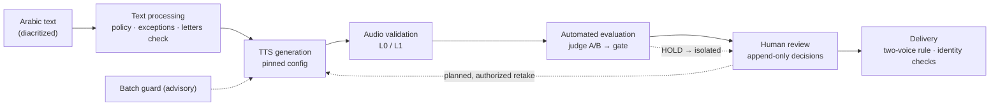

<p align="center">
  
</p>

<h1 align="center">Arabic TTS Engineering Pipeline</h1>

<p align="center">
  <strong>Producing, evaluating and delivering two-voice Arabic pronunciation audio — with the gates that keep "generated" from being mistaken for "approved".</strong>
</p>

<p align="center">
  
  
  
  
  
</p>

<p align="center">
  <a href="#interactive-engineering-demo">Demo</a> · <a href="#1-project-overview">Overview</a> · <a href="#3-system-architecture">Architecture</a> · <a href="#4-technology-stack--model-configuration">Stack</a> · <a href="#5-engineering-journey">Journey</a> · <a href="#9-synthetic-demo">Demo</a> · <a href="docs/CASE_STUDY.md">Case study</a>
</p>

> [!IMPORTANT]
> This repository is a public, offline **re-implementation of the engineering patterns** of a private production project. It uses synthetic data and a deterministic tone generator; the WAV files are **not Arabic speech**, and the simulated judge, gate weights and guard thresholds are illustrative. It contains none of the private project's data, recordings, prompts, configuration or code.

## Interactive Engineering Demo

A browser dashboard that simulates the pipeline end to end: run one of seven scenarios and watch the male and female paths move through Arabic Input → Text Policy → TTS Generation → L0/L1 Validation → J1 Evaluation → Quality Gate → Human Review → Delivery, with manual stages shown differently from automatic ones.

<p align="center"><a href="https://morooj66.github.io/arabic-tts-engineering-pipeline/interactive-demo/"><b>▶ Launch Interactive Demo</b></a></p>

It runs entirely in your browser on synthetic data: it does not call Gemini or any API, and it shows no production recordings.

## 1. Project Overview

**Problem.** A dictionary needed spoken pronunciations of fully diacritized Arabic headwords in a male and a female voice. For isolated words, the failures that matter sit at the **edges of the word**: audible tanween, a leaked final short vowel, a changed letter, a wrongly voiced ta marbuta. TTS output is non-deterministic, automated judges are imperfect, and human labels are noisy — so "it sounded fine once" is not evidence.

**Approach.** Separate *producing* audio from *trusting* it: a deliberate text policy, a staged and resumable pipeline, an audio-only judge used as evidence, a rule-based quality gate, append-only human review, and delivery rules verified by content identity.

## 2. Engineering Highlights

| Area | What was designed | Where to look |
|---|---|---|
| Arabic text policy | Pausal (waqf) vs verbatim text per voice; narrow per-word overrides; a *letters-preserved* check | [`pausal.py`](src/arabic_tts_pipeline/pausal.py) |
| Production pipeline | Python orchestrator, SQLite state, bounded batches, pinned configs, hard cost caps, classified failures with authorized retakes, resume | [`pipeline.py`](src/arabic_tts_pipeline/pipeline.py), [`state.py`](src/arabic_tts_pipeline/state.py) |
| Automated evaluation | Two-pass audio judge (what was heard / targeted yes-no), evidence only | [`judge.py`](src/arabic_tts_pipeline/judge.py) |
| Quality gate | Hard faults block, weighted soft risks, frozen threshold; failures isolated, never deleted | [`gate.py`](src/arabic_tts_pipeline/gate.py) |
| Batch guard | Repeated-error monitor that evolved from *stop on trip* to *advisory* "completion mode" | [`guard.py`](src/arabic_tts_pipeline/guard.py) |
| Human review | Append-only decisions bound to a recording's SHA-256; later decisions supersede by reference | [`reviewlog.py`](src/arabic_tts_pipeline/reviewlog.py) |
| Delivery | A word ships only with two valid voices; auto-ready is counted apart from human-accepted; 7-column import export | [`delivery.py`](src/arabic_tts_pipeline/delivery.py) |

**My engineering contribution:** system design and stage contracts; the experiments and blind listening reviews; the decisions to freeze the model, voices and text policy; the stop/continue policy and completion mode; production-pipeline development; improving recording quality through the text policy and retake rules; the automated-evaluation and human-review design; protection of approved recordings; and verification of the delivered files.

## 3. System Architecture



Components, stage contracts and the reasoning behind each decision — including what is Production, Experimental or Legacy — are in [`docs/ARCHITECTURE.md`](docs/ARCHITECTURE.md).

## 4. Technology Stack & Model Configuration

| Status | Component | Configuration |
|---|---|---|
| **Production** | TTS provider / model | Google Gemini · `gemini-3.8-flash-tts` |
| **Production** | Male voice | **Charon** (prebuilt voice), Interactions API, waqf text policy |
| **Production** | Female voice | **Kore** (prebuilt voice), `generateContent`, text sent verbatim |
| **Production** | Automated evaluation | Gemini Judge — two passes (A: what was heard, B: yes/no questions), audio-only input |
| **Production** | Orchestration & state | Python, SQLite (append-only tables enforced by triggers), Node.js request builders |
| **Production** | Quality control | Rule-based quality gate, repeated-error guard in completion mode, failure router (proposes retakes; a person authorizes them) |
| **Production** | Storage & delivery | Separate authorization-gated upload tool: conditional writes (no overwrite), canary first, size / MD5 / SHA-256 verification |
| **Legacy** | Earlier automation | n8n workflow with `gemini-2.5-flash-preview-tts`; uploaded files automatically as it generated them — superseded by the Python pipeline |
| **Experimental** | Other voices & settings | Other male voices and prompt variants (superseded by Charon); temperature / seed controls on Kore (no stability gain); forced alignment (excluded from evaluation) |

No comparison between TTS providers was run or is claimed. This repository itself calls no provider: it uses the Python standard library, SQLite and a deterministic tone.

## 5. Engineering Journey

1. **Workflow automation (n8n).** A chunked read → TTS → automatic upload → write-back workflow gave a first deliverable but no evaluation, no per-word text policy and no per-voice partial retry.
2. **Python pipeline.** Resume, unique attempts per (entry, voice), pinned configurations that stop a run on mismatch, caps, and tests.
3. **Model and voice selection.** The newer Gemini TTS model; several male voices and prompt variants tried and superseded; Charon adopted with every other setting held identical; Kore frozen.
4. **Text policy.** Blind listening showed the end-of-word problem is best fixed in the *input* (pausal form), not the prompt.
5. **Evaluation.** A two-pass judge and a gate whose threshold was frozen from development data.
6. **Completion mode.** The guard stopped legitimate production, so quality rules became advisories.
7. **Review and delivery.** Append-only decisions, two-voice rule, identity-verified exports.

## 6. Key Challenges & Solutions

| Challenge | Solution | Detail |
|---|---|---|
| Audible tanween / extra final vowel | Pausal text policy + letters-preserved check | [Case study §4.1](docs/CASE_STUDY.md) |
| Trusting an imperfect judge and noisy labels | Judge as evidence; frozen threshold; dev vs independent data kept apart | §4.2 |
| A stop rule that blocked valid work | Completion mode | §4.3 |
| New takes replacing approved ones | Byte-identity checks, unique attempts, append-only store, SHA-256-bound decisions | §4.4 |
| Live links that point to the wrong audio | Verify by size, ETag/MD5 and SHA-256, not by URL | §4.5 |
| Overwriting or auto-uploading reviewed audio | Upload as a separate authorized stage: conditional writes, canary, post-upload verification | §4.6 · [n8n vs Python](docs/ARCHITECTURE.md) |

## 7. Quality Assurance & Evaluation

Layered and separable: technical WAV checks → judge passes → quality gate → human review. A gate pass means "no blocking fault found", never approval. Unit tests cover the policy, gate, guard, state machine, review log, delivery rules and export contract. See [`docs/QUALITY_ASSURANCE.md`](docs/QUALITY_ASSURANCE.md).

## 8. Results & Validation

Production figures of the originating organization are not published. Descriptively: the private project delivered complete two-voice words only, kept *human-accepted* apart from *automatically ready* recordings, and verified its final import file against the live objects. **Production completion is not human approval.**

For this repository's **synthetic** suite: 34 Python and 9 JavaScript offline tests pass, and the two-voice demo reproduces every branch (retake, isolation, human accept/reject, incomplete pair; the demo automates the retake that production leaves to a person). These results concern the demo only. Details: [`docs/RESULTS.md`](docs/RESULTS.md).

## 9. Synthetic Demo

The browser demo is described [above](#interactive-engineering-demo) (source in [`docs/interactive-demo/`](docs/interactive-demo/)).

### Command-line examples

```bash
git clone https://github.com/morooj66/arabic-tts-engineering-pipeline.git && cd arabic-tts-engineering-pipeline
make test                 # 34 Python tests + 9 JavaScript rule tests
make demo                 # single voice: ingest → mock TTS → WAV checks → review queue
make demo-two-voice       # policy → simulated judge → gate → guard → review log → delivery rules
```

The two-voice demo processes 12 synthetic entries with injected faults and writes `delivery_two_voice.csv`, `incomplete_words.csv`, `platform_tasks.csv` (7-column contract, `example.invalid` URLs), `review_log.jsonl` and a guard log. Use `--guard-mode strict` to see the original stop-on-trip behaviour.

## 10. Documentation

| Document | Covers |
|---|---|
| [Case study](docs/CASE_STUDY.md) | Journey, experiments, challenges, decisions, lessons — with evidence and limits |
| [Architecture & decisions](docs/ARCHITECTURE.md) | Mermaid flow, stage contracts, Production / Experimental / Legacy |
| [Results](docs/RESULTS.md) | What is and is not claimed |
| [Interactive demo](https://morooj66.github.io/arabic-tts-engineering-pipeline/interactive-demo/) · [Workflow](docs/WORKFLOW.md) · [CLI walkthrough](docs/DEMO.md) | Browser simulation; status transitions; reproducible command-line runs |
| [Quality assurance](docs/QUALITY_ASSURANCE.md) | Checks, test scope, limits |
| [Public re-implementation](docs/PUBLIC_REIMPLEMENTATION.md) | Retained, simplified and omitted |

**Limitations.** Re-implementation, not the production system; mock audio is not speech; the judge is simulated; the private project used one provider family; single process, no hosted dashboard or reviewer UI. No license is currently included.
