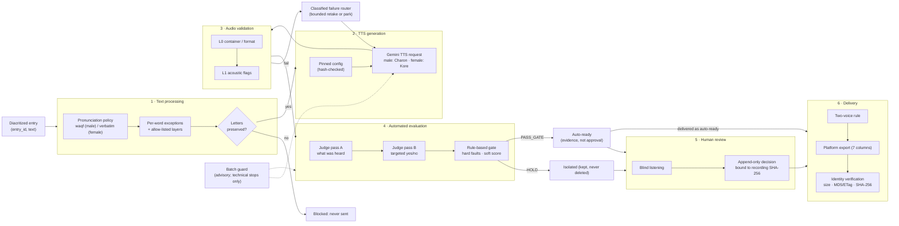
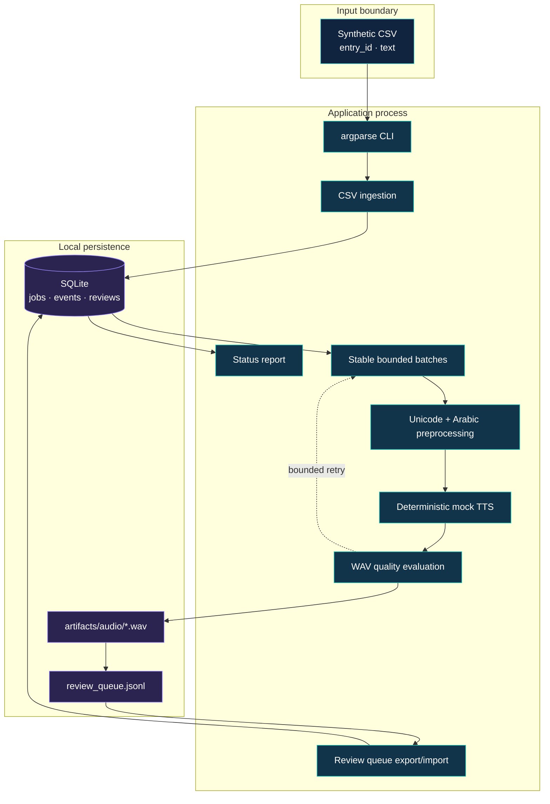

# Architecture & Engineering Decisions

[← README](../README.md) · [Case study](CASE_STUDY.md) · [Workflow](WORKFLOW.md) · [Quality Assurance](QUALITY_ASSURANCE.md)

This page has three parts: the **production architecture** that the project converged on (described from the original system's code and docs), the **engineering decisions** behind it, and the **reference implementation** in this repository, which re-creates the patterns with synthetic data.

## 1. End-to-end flow (production design)

Stage contract: *generation* never reads QA or review data; the *judge* sees audio only; the *decision* stage reads stage outputs and **never writes an approval**; *human review* is the only path to "human accepted".

### Which path did what: n8n (legacy) vs Python (production)

Not every step existed in both paths. This table is taken from each path's own code and documentation.

| Step | n8n workflow (legacy) | Python pipeline (production) |
|---|---|---|
| Read the entries | Spreadsheet read in bounded chunks; one entry at a time | Workbook-derived inventory; a batch planner selects eligible entries |
| Text processing | None beyond trimming the text; instructions in the prompt | Waqf / verbatim policies, per-word exceptions, letters-preserved check |
| TTS generation | `gemini-2.5-flash-preview-tts`, `generateContent`, male then female, 4 tries with a 3 s wait | `gemini-3.8-flash-tts`; Charon via the Interactions API, Kore via `generateContent`; pinned configs; one attempt per key, bounded retakes |
| Audio checks | Decode and format validation; failure status recorded | L0 container/format and L1 acoustic checks |
| Upload to object storage | **Automatic**: an S3 node in the workflow writes each file to a deterministic key `<prefix>/<entry>/gemini/<gender>/…` | **Not part of generation.** A separate, authorization-gated tool uploads reviewed or approved files (see below) |
| Upload verification | No post-upload verification documented | Size and ETag/MD5 via `HEAD`, plus an anonymous read compared by SHA-256 |
| Save links, ids and status | Results sheet with per-voice stage statuses (e.g. input invalid, audio validation failed, upload failed) | SQLite state and events; links follow the same deterministic key layout and are written to delivery workbooks |
| Network / upload errors | Retry on the TTS call; upload errors continue and are recorded; a rerun retries entries not yet successful (both voices retried together — a documented trade-off) | Classified retry router for generation; the upload tool stops at the first failure and never overwrites |
| Resume | Skips entries already uploaded and recorded | Each stage resumes from recorded work; a lost-metadata WAV is adopted; `STOP` file and hard caps |
| Automated evaluation, gate, human review, approved-recording protection | — | Yes (Judge, gate, guard, append-only review, byte-identity checks) |
| Delivery files | Results sheet | Two-voice delivery workbooks verified against live objects |

### Storage and upload (Python era)
- **Authorization.** Uploads are a separate stage. Every command is a dry run unless an explicit flag and an exact confirmation phrase (derived from the manifest) are given.
- **No overwrite.** Each object is written with a conditional write (`If-None-Match: *`) and a SHA-256 checksum; if a key already exists the run refuses. Keys are restricted to the intended prefix.
- **Canary first.** One object is written and verified before the rest; the first failure stops the run.
- **Verification.** For each object: size and ETag/MD5 from `HEAD`, then an anonymous `GET` whose SHA-256 must equal the local file. Final delivery files were verified the same way and recorded with a progress log, and the import workbook was checked row by row against the live objects.
- **Limits.** There is no automatic upload retry; a failed batch is resumed deliberately.

### Production, Experimental, Legacy
| Status | Components |
|---|---|
| **Production** | `gemini-3.8-flash-tts` with Charon (male) / Kore (female); Python orchestrator and SQLite state; text policies; Gemini Judge (two passes); rule-based gate; guard in completion mode; append-only review store; delivery verification |
| **Experimental** (documented, not in the final system) | Other male voices and prompt variants; temperature / seed controls; forced alignment (excluded from evaluation) |
| **Legacy** | n8n workflow with `gemini-2.5-flash-preview-tts` (chunked read → TTS → upload → write-back) |

## 2. Engineering decisions

Each decision lists the evidence in the project record.

**Why Python instead of n8n for production?**
The n8n workflow (27 nodes) achieved bounded memory and per-call retry, and its documentation lists what it could not do: no per-voice partial retry, no evaluation, no per-word text policy. Production needed a unique-attempt constraint per (entry, voice), resume of partially completed batches, pinned configurations that stop a run on mismatch, append-only audit tables, cost caps and testable pure functions. Those were implemented in Python with SQLite triggers and unit tests. (No separate migration memo exists; this rationale is reconstructed from what each system documents and enforces.)

**Why Quality Gates?**
Technical validity says nothing about the specific faults that matter for headwords (audible tanween, extra final vowel, changed letters). A gate turns judge answers into a repeatable rule: hard faults block, soft risks add weighted points, a take passes below a frozen threshold chosen on development data only. It makes review effort proportional to risk and makes failures explainable.

**Why is the Gemini judge not enough without human review?**
(1) Its false-pass rate on independent data was never established, and measurement code refuses to report on data that overlaps development. (2) Some faults are not machine-detectable (speed, exaggerated shadda). (3) A canary showed human labels are noisy too, so the judge is calibrated against humans *and* kept advisory. A pass is recorded as "no blocking fault found", never as approval.

**How are approved recordings protected from replacement?**
Registry files and approved WAVs are verified byte-identical around every live stage; one generation attempt per (entry, voice) is enforced by a UNIQUE constraint; decisions are keyed by the recording's SHA-256 so they never transfer to a new take; uploads used conditional writes (no overwrite); the final export is verified by content identity against the selected local recordings.

**How does production resume after partial failure?**
Every stage records its work (WAV + metadata, judge calls) and skips it on rerun; a WAV whose metadata was lost is adopted rather than regenerated; temporary files never become final names; failures are classified and routed (bounded retake, or parked for a human); live commands need a recorded authorization, an explicit flag and an exact confirmation phrase, otherwise they are dry runs; a `STOP` file and a hard budget cap stop a stage safely.

**Why did the guard become advisory?**
The repeated-error guard protected quality but stopped legitimate production. Detection and isolation were kept; only technical, budget and data-integrity problems stop a run, and `strict` mode remains available.

## 3. Reference implementation in this repository

The single-voice core below is the original reference slice; the two-voice layer after it adds policy, simulated judge, gate, guard, review log and delivery rules. Neither contains a real provider.

### System boundary

This repository implements an offline, single-process reference pipeline. The provider is a deterministic tone generator, storage is the local filesystem, and orchestration state is SQLite. The design demonstrates production-shaped controls without claiming parity with a real speech provider or distributed production runtime.

## Implemented responsibilities

| Component | Source | Responsibility |
|---|---|---|
| Configuration | `config.py` | Validates offline provider, batch size, attempts, artifact and DB paths |
| Preprocessing | `preprocess.py` | NFC normalization, whitespace normalization, tatweel removal, Arabic character validation, limited terminal-pause example |
| Audio adapter | `audio.py` | Deterministic tone generation and WAV technical validation |
| State store | `state.py` | Job/event/review schema, idempotent ingest, state transitions, explicit review decisions |
| Orchestrator | `pipeline.py` | Stable batches, retry loop, artifact writing, QA result persistence, summary |
| CLI | `cli.py` | Run, review import, report, and review-queue export |

## Data flow and trust boundaries

1. The CSV boundary accepts only `entry_id,text` rows.
2. Unseen identifiers are inserted as `PENDING`; existing rows are not reset.
3. Text is prepared before generation. Undiacritized input is routed to linguistic review rather than guessed.
4. The mock adapter returns WAV bytes without network access.
5. Only WAV files that pass the technical gate reach `READY_FOR_REVIEW`.
6. Human decisions are imported separately and validated against the current state.

## Deliberate non-components

There is no real TTS provider, prompt, provider voice, model selection, cloud object store, message queue, concurrency layer, distributed lock, hosted monitoring, web review UI, or automatic approval path.

## Two-voice layer (added modules)

| Module | Role |
|---|---|
| `voices.py` | Two synthetic voice slots (different tone pitch) |
| `pausal.py` | Waqf / verbatim policies, narrow per-word overrides, letters-preserved check |
| `judge.py` | Simulated two-pass judge driven by injected faults (no audio is analysed) |
| `gate.py` | Hard faults, weighted soft risks, threshold, per-word selection |
| `guard.py` | Batch repeated-error monitor; `advisory` (default) or `strict` |
| `reviewlog.py` | Append-only JSONL decisions keyed by recording SHA-256, supersede chain |
| `delivery.py` | Categories, two-voice rule, CSV and 7-column platform export |
| `scenario.py` | Wires the above end to end for the `two-voice-demo` command |
